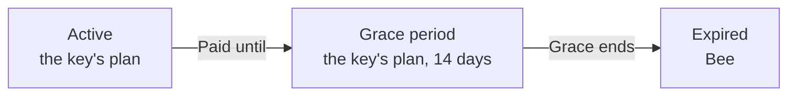

# Grace, expiry and limits

## A key's dates

A key holds until the end of the period paid for: **System → License** shows
it as **Paid until**, and the status as **Active**. It then keeps its plan for
14 more days, its grace: **Grace period**. After that the installation is on
Bee: **Expired**.



A trial has no grace: at the end of its 14 days it is **Expired** at once.

A renewed key, pasted or fetched at any time, puts its new dates in force. The
grace covers a renewal that is late: Paddle's tries at a payment that failed,
or a key emailed that is not pasted yet. A canceled subscription's last key
runs out the same way.

## On Bee, nothing stops

When a key runs out, nothing that runs is stopped, scaled down or deleted:

- apps and functions keep running, and can still be deployed and changed;
- users keep signing in, including with Google, Microsoft or OpenID Connect
  providers set up before;
- nodes stay in the swarm;
- previews stay, and are deployed again on new commits.

What changes is that nothing more of a kind can be added past Bee's limits. An
installation with 35 apps keeps all 35, and can create another once there are
fewer than 20. See [What counts](./plans-and-limits.md#what-counts).

Bee comes the same way when the key installed is for another installation,
cannot be verified, or was [moved](./moving-a-license.md) and its grace is over;
and a lower plan's limits come the same way after a downgrade.

### The clock

A key's dates are read against the installation's clock. A clock set back more
than a day before the latest time HivePaaS has seen is not believed: that latest
time is used instead. Setting a clock right by minutes changes nothing.

## Banners

Whoever may read the System module sees a banner at the top of the dashboard
when the license needs attention:

| Banner                                                                               | When                                | Hidden for |
| ------------------------------------------------------------------------------------ | ----------------------------------- | ---------- |
| `Hive trial: 3 days left.`                                                           | during a trial                      | 24 hours   |
| `The Comb license ran out on Oct 3, 2026: 13 days of grace left.`                    | in the grace period                 | 24 hours   |
| `The license has expired: this installation is on Bee.`                              | expired                             | 7 days     |
| `This license key now belongs to another installation.`                              | moved, and still holding            | 24 hours   |
| `This license key now belongs to another installation: this installation is on Bee.` | moved, and its grace over           | 7 days     |
| `The stored license key is for another installation: this installation is on Bee.`   | the key names another installation  | 7 days     |
| `The stored license key cannot be verified: this installation is on Bee.`            | the key cannot be verified          | 7 days     |
| `7 of 5 nodes: no node can be added.`                                                | more of a kind than the plan allows | 7 days     |

Closing a banner hides it, in that browser, for the time in the table. A new
situation shows again at once: another key, another date, another limit gone
over. **System → License** says what the status banners say, so they do not
show there.

There is no banner for a key that is about to run out: the renewed key arrives
by itself, or by email.

## When a limit is reached

A creation past a limit is refused, and nothing is created. Make room, by
removing one of that kind, or upgrade: see
[Where each limit is checked](./plans-and-limits.md#where-each-limit-is-checked).

### In the dashboard

A refused creation opens a dialog that names the limit, such as
**No more apps on Bee**: what the plan allows, what counts, what makes room, and
how many there are now, such as `Now 20 of 20 apps on Bee`. **Upgrade** opens
the portal's pricing page for this installation, and **View license** opens
**System → License**. Someone who may not read the System module is asked to go
to an administrator.

### Clones and previews

A clone and a preview are made by a task. The request is checked, for an answer
on screen, and the task checks again when it creates the app: two requests can
both pass, and the second task is then refused.

- **A clone** refused fails its task, whose log says why. Its
  [notification target](../configuring-apps/cloning.md#when-a-clone-ends) is
  told, if it has one.
- **A preview** refused in its task, as one a pull request comment asked for,
  is reported on its pull request: HivePaaS comments there, such as
  `Bee runs 2 previews at a time: close one, or upgrade.` The app's notification
  target for failed deployments is told the same, as `Preview refused`. Close
  another pull request, whose preview goes with it, or upgrade, then comment
  `/hivepaas deploy` again.

### Nodes

At the limit, HivePaaS gives no command to join a node. A server can still
join with `docker swarm join` and the swarm's join token, which HivePaaS cannot
prevent: it then shows a banner, such as `3 of 2 nodes: no node can be added.`,
and does nothing else.

### Through the API

A refusal is answered `412`, with the code `ERR_PLAN_LIMIT_REACHED`:

```json
{
  "status": 412,
  "code": "ERR_PLAN_LIMIT_REACHED",
  "title": "Precondition Failed",
  "detail": "The Bee plan allows 20 apps. Remove one, or upgrade.",
  "params": { "Limit": "apps", "Max": 20, "Plan": "bee" }
}
```

It is the one error whose body carries `params`:

| Param   | Holds                                                                                          |
| ------- | ---------------------------------------------------------------------------------------------- |
| `Limit` | `nodes`, `users`, `apps`, `functions`, `previews` or `sign-in-providers`                       |
| `Max`   | the most the plan allows; `0` for a kind the plan does not include, as Bee's sign-in providers |
| `Plan`  | the plan in force: `bee`, `comb`, `hive`, `colony` or `apiary`                                 |

The [CLI](../cli/scripting.md#exit-codes) prints the message with its code and
exits with `6`. The [MCP server](../integrations/mcp-server.md#plan-limits)
tells the assistant not to try again, and to tell you.
