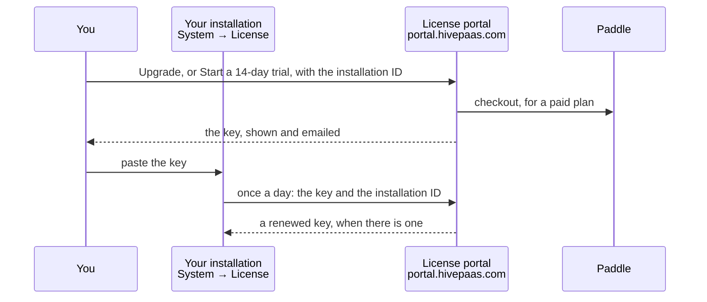

# Plans and licenses

HivePaaS is free and open source, under the Apache 2.0 license. An installation
without a license key runs on **Bee**, the free plan, with no time limit: 2
nodes, 2 users, 20 apps, 20 functions and 2 pull request previews at a time. A
license key lifts those limits for one installation.

| Plan       | Price                          | For                                              |
| ---------- | ------------------------------ | ------------------------------------------------ |
| **Bee**    | free                           | what HivePaaS runs without a key                 |
| **Comb**   | $4.99 a month, $47.99 a year   | a small team on a few nodes: 5 nodes, 5 users    |
| **Hive**   | $12.99 a month, $124.99 a year | a growing team: 10 nodes, 10 users. 14-day trial |
| **Colony** | $24.99 a month, $239.99 a year | larger teams and clusters: 25 nodes, 30 users    |
| **Apiary** | quoted                         | many nodes or users, or several installations    |

Every paid plan has no limit on apps, functions or previews, and every sign-in
provider. The full table, and what counts towards each limit, is in
[Plans and limits](./plans-and-limits.md).

## What holds on every plan

- **A limit only stops creating.** Nothing that runs is stopped, scaled down or
  deleted: not over a limit, not when a key runs out, not after a downgrade. An
  installation over a limit keeps everything, and adds nothing more of that
  kind.
- **Keys work offline.** HivePaaS checks a key against public keys built into
  it: no account to sign in to, no connection needed.
- **No telemetry.** An installation without a key never contacts the license
  portal. One with a key asks it once a day for a renewed key, sending the key
  and the installation's ID and nothing else, and that can be turned off: see
  [Renewal and privacy](./renewal-and-privacy.md).

## How it fits together

1. **System → License**, in your dashboard, shows the installation's ID, its
   plan, and how much of each limit is used.
2. Its **Upgrade** and **Start a 14-day trial** buttons open the license portal,
   with the installation's ID filled in. There you start a trial, or buy a plan:
   [Paddle](https://www.paddle.com) takes the payment.
3. The portal shows the key, and emails it. Paste it into **System → License**.
4. Renewals reach the installation by themselves, or by email to paste.

| Where                                           | What                                                                                                     |
| ----------------------------------------------- | -------------------------------------------------------------------------------------------------------- |
| **System → License**, in your dashboard         | the plan and its status, usage against each limit, the installation ID, installing a key, online renewal |
| The license portal, `portal.hivepaas.com`       | trials, buying, changing a plan, your keys under **Licenses**, moving a license                          |
| Paddle, through the portal's **Manage billing** | your payment method, invoices, canceling                                                                 |

**System → License** shows to whoever may read the System module: every admin,
and members given it. Installing a key takes **Write** on it.

## In this section

- [Plans and limits](./plans-and-limits.md): the plans, what counts towards each
  limit, and the sign-in providers Bee has.
- [Install a license key](./install-a-license-key.md): the installation ID,
  pasting a key, and why one is refused.
- [Trial](./trial.md): 14 days of Hive, without a card.
- [Buying and billing](./buying-and-billing.md): checkout, changing a plan,
  canceling, refunds.
- [Renewal and privacy](./renewal-and-privacy.md): renewal by email and online,
  exactly what is sent, and turning it off.
- [Grace, expiry and limits](./grace-expiry-and-limits.md): what happens when a
  key runs out, and when a limit is reached.
- [Moving a license](./moving-a-license.md): to a swarm made again, or a new
  server.
